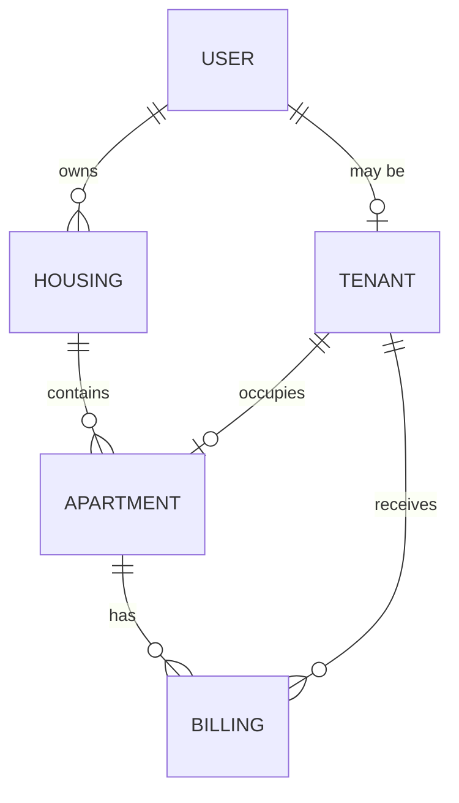

# Housemaid API

[](https://dotnet.microsoft.com/)
[](https://learn.microsoft.com/aspnet/core/)
[](https://learn.microsoft.com/ef/core/)
[](https://www.postgresql.org/)
[](https://jwt.io/)

Housemaid is an ASP.NET Core API for managing buildings, apartments, tenant assignments, and monthly billing. It uses ASP.NET Core Identity for users, JWT bearer tokens for API authentication, and Entity Framework Core with PostgreSQL for persistence.

## Capabilities

- Register and log in users.
- Create, list, update, and delete owner-managed buildings.
- Add and list apartments, assign or remove tenants, and remove eligible apartments.
- Create or update an apartment's bill for a given month.
- Let tenants retrieve current-month billing and billing history, optionally filtered by year and month.
- Expose OpenAPI documentation in the Development environment.

## Design Model

The current domain is organized around property ownership and occupancy:



- A `User` can own multiple `Housing` records.
- A `Housing` contains multiple `Apartment` records.
- A tenant profile is linked one-to-one with a user. In the current schema, `Tenant.UserId` is also its primary key.
- Apartment occupancy is represented by nullable `Apartment.TenantId`, which references the tenant record. A vacant apartment has no tenant ID.
- `Billing` records belong to both an apartment and a tenant. `IssuedAt` identifies the billing period; unpaid bills may have no `PaidAt` date.

The diagram shows the intended domain relationships. The EF configuration currently has some redundant or unwired location fields; see [Design Improvements](#design-improvements) before extending the model.

## Tenant Separation

The API uses **application-level row scoping** in a shared database:

- Authenticated owner endpoints verify that the requested building belongs to the caller by matching `Housing.OwnerId` to the JWT name-identifier claim. Apartment operations scope through that owned building.
- Tenant billing endpoints use the caller's JWT name-identifier as `Tenant.UserId` and filter bills by `Billing.TenantId`.
- Tenant billing endpoints require authentication. Owner-facing apartment and building controllers also require JWT authentication.

This is not database-per-tenant isolation or PostgreSQL row-level security. The separation depends on each query applying its owner or tenant predicate correctly. Keep that predicate close to data access, and cover cross-owner and cross-tenant access with authorization tests.

## Local Setup

Prerequisites: .NET 10 SDK and PostgreSQL.

1. Configure `ConnectionStrings:DummyDB` and the JWT `Key`, `Issuer`, and `Audience` values using local configuration or environment variables. Do not commit production secrets.
2. From this project directory, apply the EF Core migrations:

   ```sh
   dotnet ef database update
   ```

3. Start the API:

   ```sh
   dotnet run
   ```

The HTTP launch profile listens on `http://localhost:5171`. API requests for the available routes and an end-to-end sample flow are in [Housemaid.api.http](Housemaid.api.http).

## Design Improvements

1. **Give tenancy its own identity and lifecycle.** `Tenant.UserId` is the primary key, so a user can have only one tenant record, including after an ended tenancy. A separate `TenantId` or `LeaseId` would support multiple historical tenancies and re-letting. Enforce one active lease per apartment and prevent overlapping active lease dates.
2. **Remove or configure redundant location fields.** `Housing.TenantId` is not currently mapped as a relationship, and `Tenant.ApartmentId` is not the configured apartment foreign key. `Apartment.TenantId` is the actual occupancy link. Keep one authoritative relationship or configure the other fields with explicit foreign keys and consistency rules.
3. **Enforce one bill per period in the database.** The monthly update currently looks up a bill by apartment, tenant, and month, but concurrent requests can still create duplicates. Add a unique index for the billing-period key and handle uniqueness conflicts; storing a normalized year/month or period-start value makes that key explicit.
4. **Test authorization boundaries.** Add integration tests proving an owner cannot operate on another owner's apartments and a tenant cannot read another tenant's bills. Consider centralizing owner/tenant authorization policies as endpoint coverage grows.
5. **Make data retention and delete behavior explicit.** Billing is historical data. Prefer ending a tenancy and archiving or deactivating an apartment over cascading deletes that could erase records needed for accounting.
6. **Return response DTOs consistently.** Project API responses to dedicated DTOs rather than returning EF entities with navigation properties. This prevents reference cycles and keeps persistence changes from unintentionally changing the public API.
